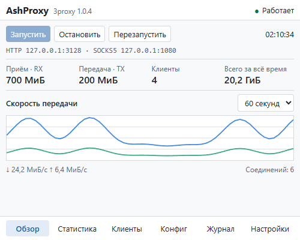
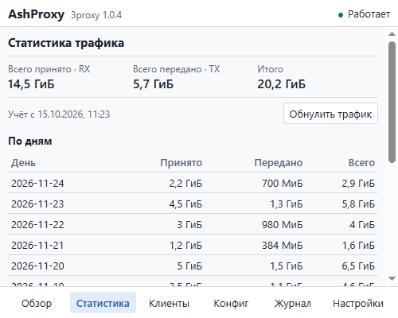
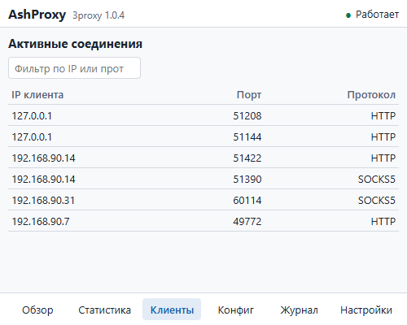

# AshProxy

AshProxy — прокси-сервер для Windows с графической оболочкой: приложение на
Wails 3 запускает и сопровождает встроенное ядро 3proxy, а всё управление —
запуск, доступ, трафик и соединения — идёт из окна программы.

[Скачать сборку](https://github.com/ashtray01/ashproxy/releases) ·
[Быстрый старт](desktop/README.ru.md) ·
[Сборки для Windows](https://github.com/ashtray01/ashproxy/actions/workflows/ashproxy-desktop.yml)



## Возможности

- **HTTP и SOCKS5.** HTTP-прокси с HTTPS через `CONNECT` и SOCKS5 на выбранных
  портах; порт `0` отключает протокол. Ядро слушает только локальный или
  частный IPv4-адрес.
- **Гибкий доступ.** Несколько разрешённых подсетей в одном поле, маски от `/0`
  до `/32`, адрес без маски считается узлом `/32`, `0.0.0.0/0` разрешает всех.
  При таком открытом доступе интерфейс предупреждает о рисках.
- **Пароль и лимиты.** Аутентификация по логину и паролю (пароль хранится
  солёным проверочным хешем 3proxy), ограничение скорости приёма и передачи.
- **Родительский прокси.** Направление трафика через внешний HTTP `CONNECT` или
  SOCKS5-сервер.
- **Статистика.** Суммарный трафик за всё время, таблицы по дням и месяцам,
  график скорости за 5 минут — 30 дней. Кнопка «Обнулить трафик» очищает
  счётчики, не останавливая прокси.
- **Наблюдение.** Активные входящие соединения и журнал текущего сеанса.
- **Рабочий стол.** Значок в трее, запуск при входе в Windows, запуск свёрнутым,
  светлая и тёмная темы.
- **Резервные копии.** Последние сохранённые конфигурации с восстановлением.
- **Портативность.** ZIP без установки: распаковать и запустить `ashproxy.exe`.

## Скриншоты

<p>
  
  
</p>
<p>
  
</p>

## Установка

1. Скачайте `ashproxy-1.0.0-windows-amd64.zip` из
   [релизов](https://github.com/ashtray01/ashproxy/releases) или соберите сами.
2. Распакуйте архив целиком и запустите `ashproxy.exe`.
3. Нужен системный Microsoft Edge WebView2 Runtime — в Windows 11 он уже есть,
   для Windows 10 при необходимости
   [установите отдельно](https://developer.microsoft.com/edge/webview2/).
4. Нажмите **Запустить** и укажите в браузере или программе HTTP-прокси
   `127.0.0.1:3128` либо SOCKS5 `127.0.0.1:1080`.

Настройки и история трафика хранятся в `%LOCALAPPDATA%\AshProxy`. Подробное
описание интерфейса — в [desktop/README.ru.md](desktop/README.ru.md).

## Сборка

Нужны Go 1.26, Node.js 24 и компилятор C для ядра (на Windows — msys2 UCRT64).

```powershell
# ядро 3proxy из каталога src/
cp Makefile.win src/Makefile.var
make -C src -j4 OPENSSL_CHECK=false PCRE_CHECK=false EXTRA_CFLAGS=-DASHPROXY_DESKTOP ../bin/3proxy.exe
mkdir desktop/core; cp bin/3proxy.exe desktop/core/

# интерфейс
cd desktop/frontend; npm ci; npm run build; cd ..

# приложение
cd desktop; go vet ./...; go test ./...; go build -trimpath -ldflags '-s -w -H=windowsgui' -o ashproxy.exe .
```

`go test` в `desktop/engine` запускает собранное ядро и проверяет протоколы,
телеметрию, статистику и откат конфигурации. Иконку окна, трея и исполняемого
файла пересобирает `desktop/tools/make-icon.ps1` из `icon.png`.

## Ядро 3proxy

Прокси-ядро и его документация — оригинальный проект
[3proxy](https://github.com/3proxy/3proxy) (© 2002–2026 Владимир «3APA3A»
Дубровин). Обновления ядра подтягиваются оттуда; оболочка, сборка для Windows,
CI и распространение живут в этом репозитории. В дереве остались только
исходники ядра (`src/`) и сборочные файлы для Windows (`Makefile.win`);
документация, man-страницы, конфиги-примеры, пакеты deb/rpm, Docker-образы и
тестовые стенды — в оригинальном репозитории. Лицензии — [copying](copying) и
[authors](authors).

## Состояние

Версия 1.0.0 — рабочая сборка обычного пользовательского режима. Готовы запуск и
остановка ядра, подсети, пароль, лимиты, родительский прокси, статистика, трей,
автозапуск и восстановление конфигурации; запуск и перезапуск проверены на
чистой виртуальной машине. Ещё не сделаны служба Windows, управление отдельными
соединениями, замер задержки, мультипользовательский режим, английская
локализация, проверка обновлений и полная матрица проверок Windows 10/11.

Издатель: AshSoft Ltd. Бинарники не подписаны Authenticode, поэтому Windows
показывает издателя из свойств файла, а не подпись.

---

© 2026 AshSoft Ltd. Владелец: ashtray · [ashtray@icloud.com](mailto:ashtray@icloud.com)
