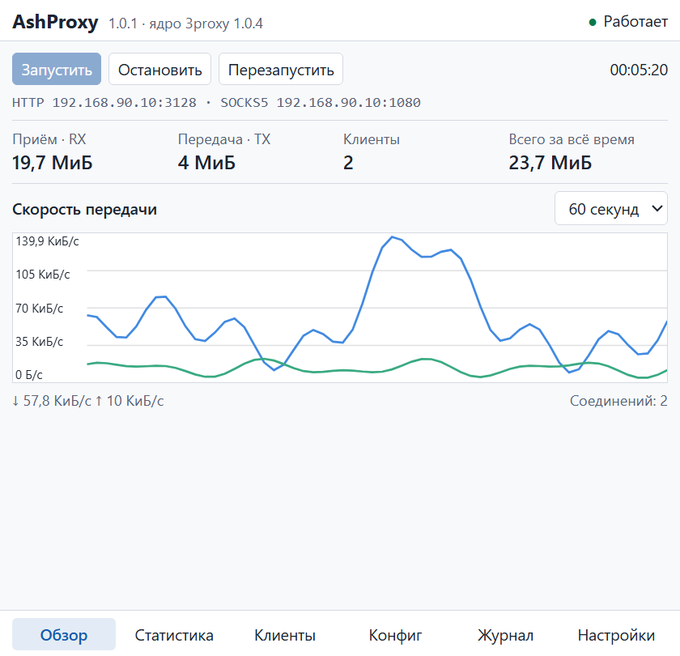
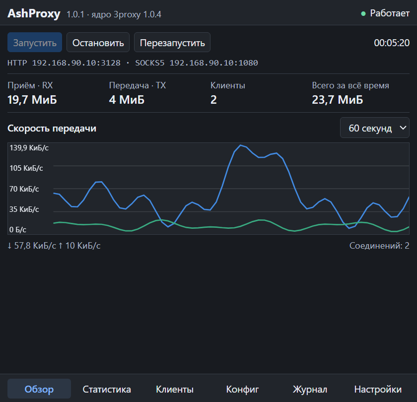
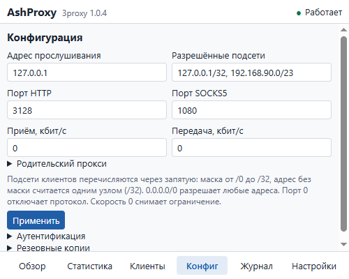

# AshProxy

Портативный HTTP- и SOCKS5-прокси для Windows x64. AshProxy запускает ядро 3proxy и показывает в одном окне, кто подключён, сколько трафика прошло и с какой скоростью идут приём и передача.

**[Скачать для Windows x64](https://github.com/ashtray01/ashproxy/releases/latest)** · [Руководство пользователя](desktop/README.ru.md) · [Сборки GitHub Actions](https://github.com/ashtray01/ashproxy/actions/workflows/ashproxy-desktop.yml)

| Светлая тема | Тёмная тема |
| :---: | :---: |
| [](desktop/assets/overview-light.png) | [](desktop/assets/overview-dark.png) |

На снимках — вкладка **Обзор** версии 1.0.1 с одинаковыми демонстрационными данными. Синяя линия показывает приём, зелёная — передачу. Шкала слева подстраивается под скорость на выбранном интервале.

## Быстрый старт

1. Скачайте ZIP-архив из последнего релиза, распакуйте его целиком и откройте `ashproxy.exe`. Для интерфейса нужен [Microsoft Edge WebView2 Runtime](https://developer.microsoft.com/edge/webview2/).
2. На вкладке **Обзор** нажмите **Запустить**.
3. В настройках браузера или другого клиента укажите адрес и порт из таблицы. Системные настройки прокси Windows приложение не меняет.

| Протокол | Адрес по умолчанию | Порт |
| --- | --- | ---: |
| HTTP и HTTPS через CONNECT | `127.0.0.1` | `3128` |
| SOCKS5 | `127.0.0.1` | `1080` |

**Для клиентов из локальной сети** откройте **Конфиг**, выберите IPv4-адрес сетевого адаптера и перечислите разрешённые подсети, например `192.168.90.0/23, 10.20.20.0/24`. В настройках клиентов укажите адрес этого адаптера. Отдельный IP без маски означает один узел (`/32`), а `0.0.0.0/0` разрешает подключения с любых IPv4-адресов.

## Управление и наблюдение

| Вкладка | Что можно сделать |
| --- | --- |
| **Обзор** | Запустить или остановить прокси, увидеть текущую скорость и переключить график с последних 60 секунд на период до 30 дней. |
| **Статистика** | Посмотреть общий объём трафика и итоги по дням и месяцам. Счётчики сохраняются после перезапуска. |
| **Клиенты** и **Журнал** | Посмотреть активные входящие соединения и последние события текущего сеанса. |
| **Конфиг** | Настроить подсети, порты, пароль, лимиты скорости и родительский HTTP CONNECT или SOCKS5-прокси. Порт `0` отключает соответствующий протокол. |
| **Настройки** | Выбрать тему, включить запуск при входе в Windows и открытие в трее. |

Настройки и история находятся в `%LOCALAPPDATA%\AshProxy`. Сохранённую конфигурацию можно восстановить из резервной копии. [Подробнее о настройках и хранении данных](desktop/README.ru.md)

<details>
<summary>Посмотреть вкладки «Статистика», «Конфиг» и «Клиенты»</summary>





</details>

## Сборка

Нужны Go 1.26, Node.js 24 и компилятор C для ядра (на Windows — msys2 UCRT64).

```powershell
# ядро 3proxy из каталога src/
cp Makefile.win src/Makefile.var
make -C src -j4 OPENSSL_CHECK=false PCRE_CHECK=false EXTRA_CFLAGS=-DASHPROXY_DESKTOP ../bin/3proxy.exe
mkdir desktop/core; cp bin/3proxy.exe desktop/core/

# интерфейс
cd desktop/frontend; npm ci; npm run build; cd ..

# приложение
go vet ./...; go test ./...; go build -trimpath -ldflags '-s -w -H=windowsgui' -o ashproxy.exe .
```

`go test` в `desktop/engine` запускает собранное ядро и проверяет протоколы,
телеметрию, статистику и откат конфигурации. Иконку окна, трея и исполняемого
файла пересобирает `desktop/tools/make-icon.ps1` из `icon.png`.

## Ядро 3proxy

Прокси-ядро и его документация — оригинальный проект
[3proxy](https://github.com/3proxy/3proxy) (© 2002–2026 Владимир «3APA3A»
Дубровин). Обновления ядра подтягиваются оттуда; оболочка, сборка для Windows,
CI и распространение живут в этом репозитории. В дереве остались только
исходники ядра (`src/`) и сборочные файлы для Windows (`Makefile.win`);
документация, man-страницы, конфиги-примеры, пакеты deb/rpm, Docker-образы и
тестовые стенды — в оригинальном репозитории. Лицензии — [copying](copying) и
[authors](authors).

## Состояние

Версия 1.0.1 — рабочая сборка обычного пользовательского режима. Готовы запуск и
остановка ядра, подсети, пароль, лимиты, родительский прокси, статистика, трей,
автозапуск и восстановление конфигурации; запуск и перезапуск проверены на
чистой виртуальной машине. Ещё не сделаны служба Windows, управление отдельными
соединениями, замер задержки, мультипользовательский режим, английская
локализация, проверка обновлений и полная матрица проверок Windows 10/11.

Издатель: AshSoft Ltd. Бинарники не подписаны Authenticode, поэтому Windows
показывает издателя из свойств файла, а не подпись.

---

© 2026 AshSoft Ltd. Владелец: ashtray · [ashtray@icloud.com](mailto:ashtray@icloud.com)
